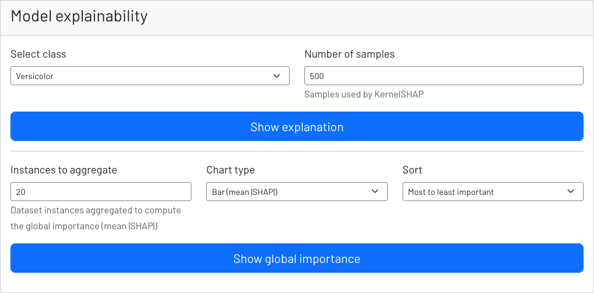
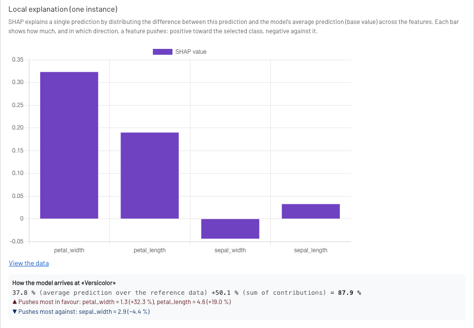
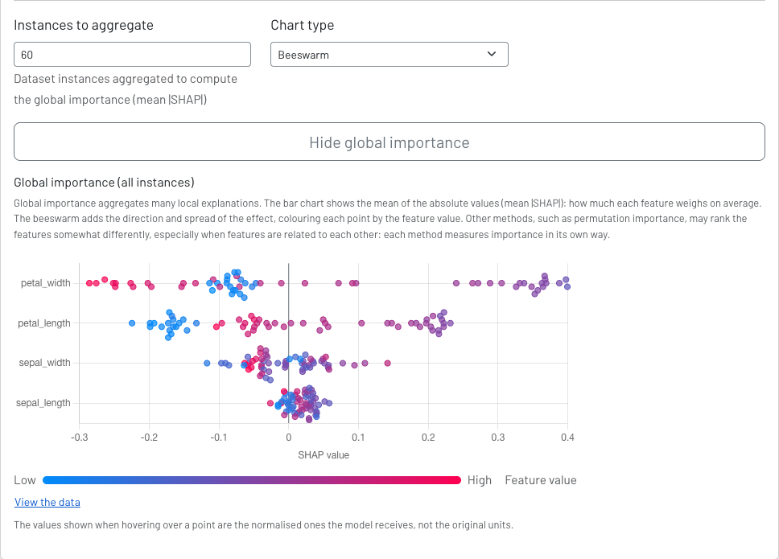
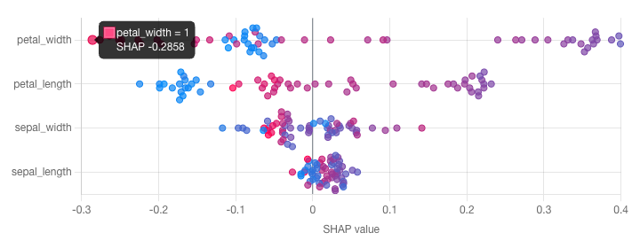

# Clasificación tabular - Explicar la predicción

En el paso anterior hemos explicado la predicción dada por el modelo. Nets4Learning permite explicar dicha predicción de forma que podemos hacernos una idea de cómo el modelo ha llegado a dicha predicción.

A la hora de explicar la predicción se hace uso de dos métodos, uno que funciona de forma agnóstica y otro que funciona recorriendo el modelo por dentro. El detector de números es el único que funciona con el segundo método llamado **LRP** (*Layer Relevance Propagation*).

Sigamos con el ejemplo del paso anterior para clasificación tabular. Esta primera imagen corresponde a la interfaz donde podemos hacer que se explique la decisión.

En la siguiente imagen podemos ver cómo dicha explicación pondera los atributos en función de cuánto han aportado, de forma que si su aportación fue positiva la barra será más alta, y si fue negativa crecerá desde el eje Y hacia valores negativos.

Más abajo podemos seleccionar que se dé una explicación global del modelo, es decir, ejecutar un número determinado de muestras de forma que la combinación de la explicación de todas ellas permita conocer qué datos son los que más influyen en el modelo en general.

A la hora de leer dicho gráfico de enjambre, debemos considerar el color de cada instancia pintada en el gráfico y en qué parte del eje X se encuentra situada. En caso de ser un valor que contribuye de forma positiva a la predicción se desplazará hacia la derecha. Cada instancia muestra su valor tanto por color (rojo para un valor alto y azul para un valor bajo de dicha característica) como en la interfaz al colocar el cursor encima de la instancia pintada.

